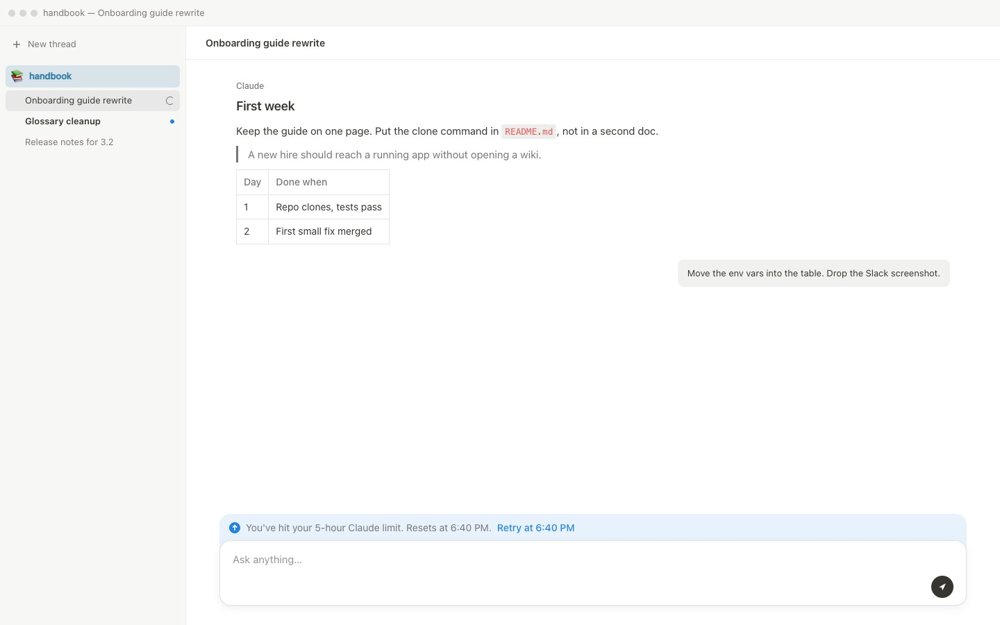

# Notion Theme

Notion's page colours and type for [BB](https://getbb.app), in light and dark.



## Contents

- [What it does](#what-it-does)
- [Install](#install)
- [Font](#font)
- [Development](#development)
- [License](#license)

## What it does

- One palette, `plugin:notion-theme:notion`, in Settings → Appearance and `bb theme list`. Light is Notion white / `#37352f`. Dark is `#191919`.
- Three content fonts — Default, Serif, Mono — applied to messages and the composer. The UI font stays Notion's default stack.
- While the palette is on, menus, dialogs, switches, your message bubble, markdown and the prompt box follow Notion's shapes.
- Hover cards close when the pointer leaves; a click pins them.
- A notice on the prompt box when a provider window is exhausted, with retry at reset.

Notion's licensed fonts (Lyon-Text and the rest) are named first. The theme falls back to system fonts when they are not installed. No account.

## Install

```sh
bb plugin install https://github.com/KosachMax/bb-plugin-notion-theme.git
bb theme set plugin:notion-theme:notion
```

Back to BB's look:

```sh
bb theme reset
```

## Font

On the plugin settings page, or:

```sh
bb plugin config notion-theme set font serif
```

Values: `default`, `serif`, `mono`.

## Development

```sh
npm install --include=dev
npm run typecheck
bb plugin build
```

## License

[MIT](LICENSE)
